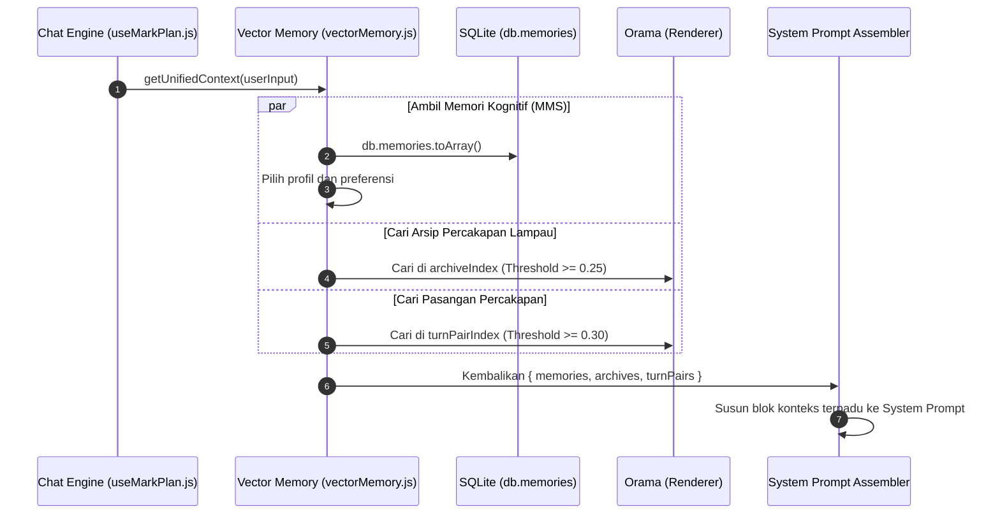

# Mesin Pencarian Vektor & Manajemen Konteks

Dokumen ini menjelaskan subsistem pencarian cerdas pada **MARK**, mencakup pembuatan embeddings vektor lokal 384-dimensi via `@huggingface/transformers`, mesin pencarian hibrida Orama WASM, dan sistem pemadatan memori sesi (_Context Management Engine_).

---

## 1. Local Embedding Engine (`vector-engine.js`)

MARK menghasilkan representasi semantik (_vector embeddings_) secara 100% lokal di mesin pengguna tanpa bergantung pada API embedding eksternal berbayar (seperti OpenAI `text-embedding-ada-002`).

### Karakteristik Model:

- **Pustaka**: [`@huggingface/transformers`](https://huggingface.co/docs/transformers.js) (Transformers.js v3)
- **Model**: `Xenova/paraphrase-multilingual-MiniLM-L12-v2`
- **Dimensi Vektor**: 384 dimensi float
- **Dukungan Bahasa**: Multilingual (termasuk Bahasa Indonesia dan Bahasa Inggris)
- **Runtime**: ONNX Runtime via WebAssembly (WASM) dengan model terkuantisasi (_quantized_ q8)
- **Lokasi Cache Model**: `~/.cache/mark-transformers/` (diunduh otomatis sekali pada pemanggilan pertama, selanjutnya 100% offline).

### Pola Inisialisasi Singleton & Queue:

Pada [`src/server/memory/vector-engine.js`](file:///d:/My%20Project/mark-project/mark/src/server/memory/vector-engine.js), pipeline diinisialisasi secara thread-safe menggunakan antrean _initWaiters_ untuk mencegah pemanggilan ganda (_race condition_) saat sistem booting:

```javascript
let extractor = null
let isInitializing = false
const initWaiters = []

export async function getExtractor() {
  if (extractor) return extractor
  if (isInitializing) {
    return new Promise((resolve) => initWaiters.push(resolve))
  }
  isInitializing = true
  try {
    extractor = await pipeline(
      'feature-extraction',
      'Xenova/paraphrase-multilingual-MiniLM-L12-v2',
      { quantized: true }
    )
    isInitializing = false
    initWaiters.forEach((resolve) => resolve(extractor))
    initWaiters.length = 0
    return extractor
  } catch (err) {
    isInitializing = false
    initWaiters.forEach((resolve) => resolve(null))
    initWaiters.length = 0
    return null
  }
}
```

---

## 2. Pencarian Hibrida Orama WASM (`orama-store.js`)

Untuk mengindeks dan mencari memori pengguna serta riwayat percakapan, MARK menggunakan engine pencarian in-memory: [`@orama/orama`](https://orama.com/).

### Indeks Aktif:

1. **`archiveIndex`**: Menyimpan dan mengindeks seluruh giliran percakapan yang diarsipkan (`chat_archives`).
2. **`memoryIndex`**: Mengindeks memori eksplisit pengguna.
3. **`turnPairIndex`**: Mengindeks pasangan pesan pengguna dan jawaban AI.

Dokumen Knowledge lama tidak lagi dimuat, dibuatkan embedding, atau dicari. Tabel SQLite `documents` hanya dipertahankan untuk kompatibilitas backup. Tool `read-document` membaca file langsung tanpa memakai indeks Knowledge.

### Algoritma Pencarian Vektor + BM25:

Orama menggabungkan pencarian teks tradisional (BM25 full-text keyword matching) dengan pencarian kemiripan kosinus vektor (_cosine vector similarity_). Hal ini menjamin kata kunci spesifik (seperti nama variabel kode atau nomor telepon) tetap dapat ditemukan, sekaligus memahami konteks sinonim pertanyaan pengguna.

### Ambang Batas Kemiripan (_Similarity Thresholds_):

- **Orama Search Threshold**: **0.25** (diatur di `src/server/memory/orama-store.js`).
- **Client Vector Memory Threshold**: **0.30** (diatur di `src/renderer/src/api/vectorMemory.js` untuk membuang memori kognitif yang tidak relevan).

---

## 3. Alur Pengambilan Konteks Terpadu (_Unified Context_)

Sebelum perintah pengguna diteruskan ke model LLM, `getUnifiedContext()` mengumpulkan memori profil/preferensi, arsip, dan pasangan percakapan yang relevan:



---

## 4. Context Management Engine (`contextManager.js`)

Mark membedakan riwayat tersimpan dari konteks yang dikirim ke model. Kompaksi mengurangi konteks aktif melalui ringkasan dan penanda pesan terakhir yang telah dirangkum; riwayat asli beserta hasil tool tetap tersimpan.

### Pemicu dan batas

- Kapasitas aplikasi saat ini `MAX_CONTEXT_TOKENS = 256000`. Ini batas internal Mark, bukan jaminan kapasitas setiap model atau server provider.
- Pemeriksaan sebelum giliran dan di dalam loop memakai ambang 90% (`GATEWAY_HYGIENE_THRESHOLD` dan `IN_LOOP_COMPACT_THRESHOLD`). Jumlah pesan saja tidak memicu kompaksi.
- Payload menghitung pesan, schema tool, dan reminder. Jika tetap terlalu besar setelah kompaksi, Mark menghentikan permintaan dengan penjelasan, bukan membuang hasil tool secara diam-diam.
- Token dihitung melalui metadata usage provider bila tersedia dan estimasi tokenizer lokal untuk pesan baru atau provider tanpa usage. Gambar menggunakan estimasi tersendiri.

### Ringkasan berbasis rekaman

Ringkasan menerima isi pesan serta rekaman `executionSteps`/`executedTools`, termasuk status dan hasilnya. Bagian tengah pesan panjang tidak lagi dibuang sebelum dikirim ke peringkas. Rekaman panjang dibagi menjadi beberapa bagian agar peringkas tetap menerima bukti yang tersedia.

Kompaksi sesi mempertahankan sedikitnya delapan pesan terakhir jika tersedia. Batas potongan diselaraskan agar pemanggilan dan hasil tool tetap berpasangan. Kompaksi di dalam loop mempertahankan bagian awal dan ekor aktif sesuai parameter caller, lalu merangkum bagian tengah. Keduanya mempertahankan tujuan, batas pengguna, progres, kendala, keputusan, berkas relevan, dan langkah berikutnya.

Ringkasan adalah hasil model dan tetap dapat kehilangan detail; riwayat asli menjadi sumber pemeriksaan ulang. Hasil tool yang tidak tersimpan dinyatakan tidak diketahui, bukan dianggap sukses. Helper pruning lama masih diekspor, tetapi jalur utama Lead Agent tidak memakainya untuk menghapus bukti sebelum ringkasan.

### Memori dan sesi provider

Profil (`profile`) dan preferensi (`preference`) tetap menjadi core memory otomatis. Arsip dan pasangan percakapan yang ditemukan melalui pencarian dipasang sebagai data historis. Rujukan pengguna dalam percakapan aktif mempunyai prioritas atas hasil pencarian riwayat.

Rotasi sesi DeepSeek Web terpisah dari kompaksi Mark. Adapter Web selalu mengirim konteks yang disiapkan caller, termasuk ringkasan jika sudah dikompaksi. Karena transport dapat membuat sesi baru saat rotasi atau retry, adapter tidak boleh hanya mengirim pesan setelah jawaban asisten terakhir.

---

## 5. Sumber Daya Terkait

- [Arsitektur Basis Data SQLite Terpusat](./state-and-database.md)
- [Pusat Orkestrasi ReAct Loop & Intent Routing](../03-agent-engine/react-loop.md)
- [Sistem Minibot Mandiri Minibots](../03-agent-engine/multi-agent-subagents.md)
