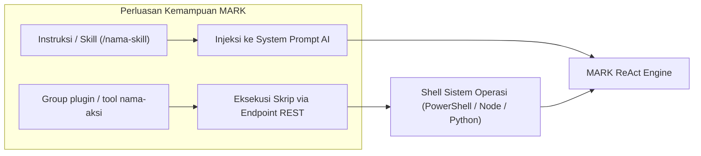

# Panduan Pembuatan Skills & Plugin Kustom

Dokumen ini memandu pengembang dalam memperluas kapabilitas sistem **MARK**, mencakup penyusunan dokumen keahlian (_Learned Skills_), sintesis keahlian otomatis (_Autonomous Skill Synthesis_), serta pembuatan plugin eksternal (_External Plugins_) dengan skema OpenAPI kustom.

---

## 1. Dua Pola Ekstensi di MARK

MARK menyediakan dua cara berbeda untuk memperluas kemampuannya:

| Pola Ekstensi           | Sasaran                                                                     | Mekanisme Eksekusi                                                        | Lokasi Penyimpanan                                  |
| :---------------------- | :-------------------------------------------------------------------------- | :------------------------------------------------------------------------ | :-------------------------------------------------- |
| **Skills (`SKILL.md`)** | Prosedur kerja bertahap, panduan perilaku, dan instruksi domain spesifik    | Diinjeksi langsung ke System Prompt saat dipicu                           | Direktori `skills/` & tabel SQLite `learned_skills` |
| **Plugins**             | Integrasi biner eksternal, CLI pihak ketiga, skrip Python/PowerShell kustom | Handler JavaScript dalam proses Node.js via `/api/plugins/execute` | `Documents/Mark Plugins/<nama>/` di home pengguna              |



---

## 2. Struktur Berkas Keahlian (`SKILL.md`)

Setiap keahlian didefinisikan dalam berkas Markdown dengan struktur metadata frontmatter YAML:

```markdown
---
name: verifikasi-kode-react
description: Prosedur pengujian dan pembersihan komponen React sebelum build produksi.
tools:
  - read-file
  - run-powershell
---

# Panduan Verifikasi Kode React

Ketika pengguna meminta verifikasi kode React, lakukan langkah-langkah berikut secara berurutan:

1. **Pemeriksaan Linter:** Jalankan `npm run lint` menggunakan tool `run-powershell`.
2. **Analisis Error:** Jika ada error ESLint, buka berkas terkait menggunakan `read-file` dan perbaiki baris yang bermasalah menggunakan `replace-content`.
3. **Validasi Build:** Jalankan `npm run build:ui` untuk memastikan bundler Vite tidak menghasilkan error kompilasi.
4. **Laporan:** Berikan ringkasan berkas yang diperbaiki kepada pengguna.
```

### Pemanggilan Skill:

Pengguna dapat memicu skill dengan mengetikkan garis miring (_slash command_) di obrolan:

```text
/verifikasi-kode-react tolong periksa komponen ChatList.jsx
```

MARK akan membaca isi berkas skill tersebut via `window.api.readSkill()` dan menyuntikkannya sebagai instruksi sistem prioritas tinggi.

---

## 3. Sintesis Keahlian Otonom (Autonomous Skill Synthesis)

MARK memiliki kemampuan belajar mandiri (_Continuous Cognitive Learning_):

- Setiap kali MARK berhasil menyelesaikan tugas kompleks multi-langkah (misalnya men-debug bug baru atau mengonfigurasi database), modul [`src/renderer/src/api/ai/skillSynthesizer.js`](file:///d:/My%20Project/mark-project/mark/src/renderer/src/api/ai/skillSynthesizer.js) secara otomatis mengevaluasi riwayat aksi yang berhasil.
- Sistem menyintesis prosedur teruji tersebut menjadi entitas keahlian baru.
- Keahlian disimpan ke dalam tabel SQLite `learned_skills` dan dapat dipanggil kembali di masa depan jika MARK menghadapi masalah serupa.

---

## 4. Pembuatan Plugin Eksternal (Custom Plugins)

Gunakan skill bawaan `/create-plugin` untuk membuat atau mengubah plugin lokal. Kontrak runtime ada di `src/main/plugins/plugin-loader.js`.

### Struktur direktori

```text
Documents/Mark Plugins/local-info/
├── plugin.json
├── index.js
└── package.json
```

`plugin.json` dan `index.js` wajib ada. Contoh ESM ini membutuhkan `package.json` berisi `{"type":"module","private":true}`. Plugin CommonJS lama tetap dapat memakai `module.exports` dan `require` sesuai tipe paketnya.

### Manifest plugin.json

```json
{
  "name": "local-info",
  "displayName": "Local Info",
  "version": "1.0.0",
  "description": "Membaca platform OS komputer lokal.",
  "isEnabled": true,
  "dependencies": [],
  "actions": [
    {
      "name": "local-info-platform",
      "description": "Membaca platform OS. query boleh string kosong.",
      "triggerHint": "pengguna menanyakan platform OS",
      "code": "const os = await import('node:os'); return { platform: os.platform() };"
    }
  ]
}
```

### Handler index.js

```js
export default {
  'local-info-platform': async ({ query }) => {
    const os = await import('node:os')
    return { platform: os.platform() }
  }
}
```

Loader menjalankan export dari `index.js`; `actions[].code` dipakai editor untuk menyimpan atau membangun ulang handler. Sinkronkan nama export, badan fungsi, dan metadata manifest. Endpoint `/api/plugins/save` menghasilkan ESM, jadi pertahankan tipe paket yang kompatibel saat menyimpan melalui editor.

Handler menerima `query` berupa string. Untuk beberapa nilai, kirim JSON string dan validasi hasil `JSON.parse` di handler. Kembalikan data yang dapat diserialisasi atau lempar `Error` untuk kegagalan. Field `reason` adalah metadata timeline agen.

Plugin diimpor dalam proses server, termasuk sebelum pengecekan `isEnabled`. Hindari efek samping di level modul; jalankan pekerjaan hanya di handler. Gunakan operasi async dan timeout untuk proses/jaringan. Field `dependencies` saja tidak memasang paket saat folder dibaca; pasang paket di direktori plugin bila diperlukan.

## 5. Group, tool, dan pengujian

- Nama plugin `local-info` menjadi group; `local-info-platform` menjadi nama tool persis seperti `actions[].name`.
- Muat melalui `read-tools` dengan `group_name: "local-info"`, atau tag `@local-info` di input.
- Nama tool memakai huruf, angka, underscore atau tanda hubung sepanjang 1–64 karakter. Nama aksi harus unik terhadap plugin aktif lainnya dan tool bawaan karena daftar tool model datar. Aksi bentrok tidak diekspos; panggilan ambigu ditolak.
- Alias lama `plugin-<nama-plugin>-<nama-aksi>` tetap diterima untuk riwayat. Schema baru memakai nama aksi langsung.
- Periksa JSON dan jalankan `node --check index.js`. Uji handler di proses Node terpisah, termasuk input tidak valid. Pengujian mutasi harus sesuai cakupan izin pengguna.
- `list-plugins` memuat ulang daftar plugin. `POST /api/plugins/reload` juga mengirim event `plugins:updated`. Pakai origin/port server aktual untuk API.
- Setelah aktif, muat group dan verifikasi pemanggilan tool melalui MARK. Laporkan hasil aktual; jika sesi masih memakai cache lama, refresh UI/sesi.
